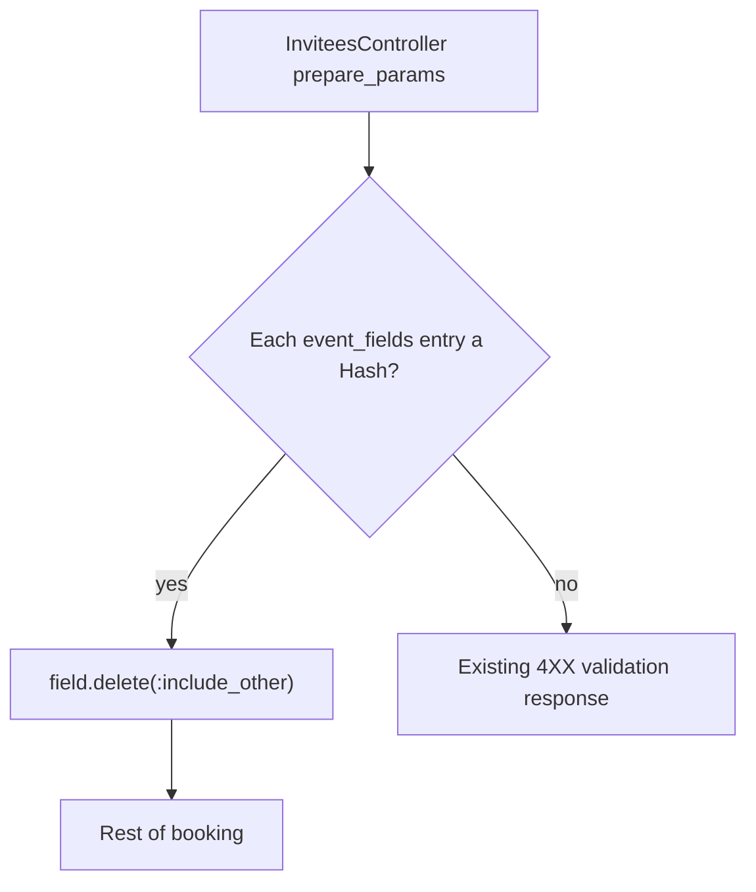

---  
name: SCH-4576 event_fields validation  
overview: In booking invitees_controller#prepare_params, event_fields entries that are strings hit String#delete(:include_other) and 500. Validate that each entry is a Hash before that call and return 4XX. Do not reject legitimate id, value, or include_other keys.  
todos:  
  - id: guard-prepare-params  
    content: In app/controllers/booking/api/invitees_controller.rb#prepare_params, reject non-Hash event_fields entries before field.delete(:include_other) and return the existing 4XX validation response  
    status: pending  
  - id: specs  
    content: Request or controller spec for array-of-UUID-strings returns 4XX with no booking; valid objects with id, value, include_other still succeed  
    status: pending  
  - id: no-contract-tightening  
    content: Do not add an allowlist of name/value only, and do not treat SCH-4730 key-stripping as this bug  
    status: pending  
isProject: false
branch: SCH-4576-reject-invalid-event-fields
pullRequest: https://github.com/calendly/booking/pull/514
started: 2026-10-09
pullRequestOpened: 2026-10-09
released: 2026-10-12
delivery:
  - repo: calendly/booking
    branch: SCH-4576-reject-invalid-event-fields
    pullRequest: https://github.com/calendly/booking/pull/514
---  
  
# Return 4XX when `event_fields` is an array of strings  
  
Shareable implementation note for [SCH-4576](https://calendlyapp.atlassian.net/browse/SCH-4576) (Scheduling · 3 SP · Ready For Dev · P2 · Low impact).  
  
Parent: [SCH-3652](https://calendlyapp.atlassian.net/browse/SCH-3652).  
  
Same production error as [SCH-3978](https://calendlyapp.atlassian.net/browse/SCH-3978) (Won't Do). SCH-3978 has the file, line, and payload the SCH-4576 description does not. Datadog issue id is identical: `13ac0374-de11-11f0-92fb-da7ad0900000`.  
  
## Goal  
  
`POST` booking that sends `event_fields` as an array of strings (UUIDs) raises `TypeError: no implicit conversion of Symbol into String` and returns **500**.  
  
The crash is in `Booking::Api::InviteesController#prepare_params` (`app/controllers/booking/api/invitees_controller.rb`, cited at line 313 on SCH-3978). The loop treats each entry as a Hash and calls `field.delete(:include_other)`. A String has `String#delete`, which only accepts Strings, so a Symbol argument raises.  
  
Validate **higher in that method** (before `delete`) and return the controller’s existing **4XX** for bad params. Do not create a booking. Do not change the happy-path object shape.  
  
What the client sends when this breaks:  
  
```json  
{  
  "event_fields": [  
    "550e8400-e29b-41d4-a716-446655440000",  
    "6ba7b810-9dad-11d1-80b4-00c04fd430c8"  
  ]  
}  
```  
  
What the backend expects (from SCH-3978):  
  
```json  
"event_fields": [  
  {  
    "id": "550e8400-e29b-41d4-a716-446655440000",  
    "value": "Some answer",  
    "include_other": false  
  }  
]  
```  
  
`id`, `value`, and `include_other` are valid keys. Do not reject them.  
  

  
## Out of scope  
  
- [SCH-4730](https://calendlyapp.atlassian.net/browse/SCH-4730) (Won't Do): Book on Behalf `POST /api/book_on_behalf` rejects **valid** modal keys (`event_fields[].id`, `event.description`, `event.guests`) in `Meetings::InviteeCreateParamsContract` and the UI shows “time cannot be booked.” That is key **allowlisting**, not this TypeError. Do not “fix” SCH-4576 by rejecting unknown keys or by stripping `id`.  
- [SCH-4108](https://calendlyapp.atlassian.net/browse/SCH-4108) / [SCH-4109](https://calendlyapp.atlassian.net/browse/SCH-4109) (Won't Do): client-injected `hair_color` persistence. Not this crash.  
- Fixing the client that sends UUID strings.  
- Datadog reporter credentials (comment thread only).  
  
The automation edge-case comment on SCH-4576 mixes those tickets into one checklist. Only the first bullet (non-object entries → 4XX, no booking, no 500) is this bug. The other bullets are related history, not acceptance criteria for SCH-4576.  
  
## Code changes  
  
### 1. Guard in `prepare_params`  
  
`app/controllers/booking/api/invitees_controller.rb`, inside `prepare_params`, before `field.delete(:include_other)`.  
  
Keep the existing strip of `include_other` for real hashes. Add a type check only:  
  
```ruby  
def prepare_params  
  # existing method body …  
  Array(event_fields).each do |field|  
    unless field.is_a?(Hash)  
      # Use the same error helper this controller already uses for invalid params.  
      # Do not raise. Do not continue into booking.  
      return render_event_fields_invalid # name TBD: match the method already in this controller  
    end  
  
    field.delete(:include_other)  
    # rest of the existing per-field logic, unchanged  
  end  
end  
```  
  
Replace `render_event_fields_invalid` with the helper this controller already uses for bad invitee params (status and JSON must match neighboring validation, not a new error schema). If `prepare_params` is not allowed to `render`, set an error and return early from the action that calls it — same response the action already uses for invalid input.  
  
Do **not** introduce `ALLOWED_KEYS = %w[name value]`. SCH-3978’s expected object uses `id`, `value`, and `include_other`. A name/value allowlist would 4XX real bookings.  
  
### 2. No new validator class unless `prepare_params` is duplicated  
  
SCH-3978 names one site: `invitees_controller.rb`. Ship the guard there. Search once for other `delete(:include_other)` on `event_fields`:  
  
```bash  
rg "delete\\(:include_other\\)" app/controllers --glob '*.rb'  
```  
  
If that is the only call site, do not add Book on Behalf, Contacts, or reschedule work in this PR. Those paths are SCH-4730’s problem (contract keys and a slot-unavailable presenter), and that ticket is Won't Do.  
  
## Tests  
  
Add a spec next to existing invitees controller/request specs (path follows whatever already covers `Booking::Api::InviteesController`).  
  
- `event_fields: ["550e8400-e29b-41d4-a716-446655440000"]` → **4XX**, response body is a validation error, **no** invitee persisted, **no** unhandled exception.  
- `event_fields: [nil]`, a bare string, and a mix of string + hash → same 4XX.  
- Valid entry `{ "id" => "550e8400-e29b-41d4-a716-446655440000", "value" => "Some answer", "include_other" => false }` still books, and `include_other` is still stripped the way it is today.  
- A missing required answer still uses the **existing** required-question error, not this new branch and not “time cannot be booked.”  
  
Run (adjust spec path after locating the existing file):  
  
```bash  
bundle exec rspec spec/controllers/booking/api/invitees_controller_spec.rb  
```  
  
## Manual check  
  
- Replay the SCH-3978 payload (array of UUID strings) against the booking invitees endpoint → 4XX, no 500.  
- Book with a real custom question object (`id`, `value`, `include_other`) → success.  
- Datadog issue `13ac0374-de11-11f0-92fb-da7ad0900000` stops for this exception.  
  
## Ticket gaps (do not block the code change)  
  
SCH-4576’s description never added the route, and triage asked for it. SCH-3978 supplies the file and the failing payload. Ryan’s comment said he would fill details; the description was not updated. Use SCH-3978 as the spec for the crash. Confirm the line number still matches `prepare_params` on current master before editing.  
