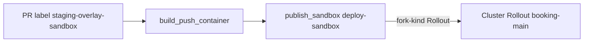

# Fork staging sandboxes from the booking Rollout

Shareable implementation note for [SCH-5125](https://calendlyapp.atlassian.net/browse/SCH-5125) (ET Scheduling · Sub-task · In Dev · P2 · Low impact).

Parent (done): [SCH-5113](https://calendlyapp.atlassian.net/browse/SCH-5113) — staging `booking-main` is a native Rollout; Deployment `booking-main` is gone ([booking PR 497](https://github.com/calendly/booking/pull/497)).

Repo: `calendly/booking`. Local checkout: `/Users/somo.banerjee/Documents/projects/SCH-5125/booking` on branch `SCH-5125-fork-sandbox-from-rollout`.

Branch: `SCH-5125-fork-sandbox-from-rollout`

Pull request: https://github.com/calendly/booking/pull/543

Constraint: `staging-overlay-sandbox` label on the pull request triggers `.github/workflows/sandbox-deploy.yml`; Publish Sandbox must target controller kind **Rollout**, not Deployment.

## Goal

After SCH-5113, staging booking runs only as a Rollout named `booking-main`. The Signadot overlay action still defaulted to forking a **Deployment** with that name.

With the `staging-overlay-sandbox` label, **Build and Push Container** succeeds, then **Publish Sandbox** fails:

`can't fetch Deployment from cluster: deployments.apps "booking-main" not found`

Example failed run: https://github.com/calendly/booking/actions/runs/40232721921

`calendly/overlaycli/.github/actions/deploy-sandbox@main` already accepts `fork-kind: "Rollout"`. Peer services (`ci-events`, `oap-api`, `commerce-service`, `ci-api`, `caf-api`) pass that input after the same Rollout cutover. Booking’s workflow was the missing line.



## Design

**Approach:** Add one `with` input on the existing `deploy-sandbox` step: `fork-kind: "Rollout"`. Leave `deployment-name`, `container-name`, and image coordinates unchanged so the fork still overlays the same logical workload name.

**Rejected:** Reintroducing a Deployment for sandbox only (defeats SCH-5113). Changing namespace or image naming (unnecessary; build already produces the correct image tag).

**Blast radius:** Only pull requests that use the staging overlay sandbox label. Production deploy paths and unlabeled PRs are unchanged.

## Out of scope

- SCH-5113 Rollout manifest, canary, or HPA work (already shipped).
- Signadot routing contract changes ([Signadot Routing](https://calendlyapp.atlassian.net/wiki/spaces/CAF/pages/6091046916/Signadot+Routing) — checked; this is workflow input only).
- Application code, Helm values under `values/`, or Docker build logic.
- Monolith (`calendly/calendly`) sandbox workflows — booking-only.

## Code changes

File: `.github/workflows/sandbox-deploy.yml`, job `publish_sandbox`, step **Create Sandbox If Labeled** (`calendly/overlaycli/.github/actions/deploy-sandbox@main`).

Add after the existing `gh-actions-read-key` input:

```yaml
fork-kind: "Rollout"
```

**Must stay as-is:** Trigger (`pull_request` + label `staging-overlay-sandbox`), `deployment-name` / `container-name` `"${{ github.event.repository.name }}-main"`, namespace `booking`, image `us-docker.pkg.dev/global-288513/container-images/booking:${{ github.event.pull_request.head.sha }}`, and the build job outputs feeding publish.

**Procedure:** No Confluence page owns “add fork-kind to deploy-sandbox.” The ticket and the same one-line fix in peer repos are the rule. Searched Confluence for `deploy-sandbox`, `fork-kind`, and `staging-overlay-sandbox`; no booking-specific procedure beyond [How to Signadot](https://calendlyapp.atlassian.net/wiki/spaces/ainc/pages/5908987907/How+to+Signadot) for exercising a sandbox after publish.

## Testing

### Local

No application tests apply (workflow-only). Before merge, confirm the branch diff is a single valid YAML line under `with:` and matches peer repos’ `fork-kind: "Rollout"` pattern.

### Shared environment (engineer / QA after the pull request exists)

This repo’s shared check is Signadot sandbox publish, not Postman or Chromatic.

1. On a booking pull request (this branch or any follow-up), add label `staging-overlay-sandbox`.
2. In GitHub Actions, open workflow **Build and Push Container** for that PR. Wait until **Publish Sandbox** completes successfully (contrast with run 40232721921).
3. **Proof:** The workflow posts a sandbox name on the pull request (deploy-sandbox comment), and the Publish Sandbox job is green.
4. Optional product check: In the Signadot browser extension, select that sandbox and route staging per [How to Signadot](https://calendlyapp.atlassian.net/wiki/spaces/ainc/pages/5908987907/How+to+Signadot); load a booking staging URL and confirm the sandbox banner — proves the forked Rollout serves traffic, not only that publish succeeded.

Storybook does not apply; booking Storybook is unrelated to this workflow file.

## Post-production

**Release event:** Merge of https://github.com/calendly/booking/pull/543 to `main` (merged 2026-10-26).

**Check:** On the next booking pull request that needs staging overlay (or a harmless test PR), add `staging-overlay-sandbox` and confirm Publish Sandbox succeeds without the Deployment-not-found error. That proves `main` carries the fix for all future sandbox builds.

## Rollback

Revert the merge commit on `main` (or remove the `fork-kind` line in a follow-up pull request). Publish Sandbox will again look for Deployment `booking-main` and fail until booking staging still has only a Rollout — so rollback restores the broken sandbox path and should only be used if `fork-kind: "Rollout"` causes an unexpected publish failure.

Rollback does not restore a Deployment; SCH-5113 remains the source of truth for controller kind.

## Sources

- Ticket: https://calendlyapp.atlassian.net/browse/SCH-5125
- Parent: https://calendlyapp.atlassian.net/browse/SCH-5113
- Failed publish run: https://github.com/calendly/booking/actions/runs/40232721921
- Pull request: https://github.com/calendly/booking/pull/543
- Signadot usage: https://calendlyapp.atlassian.net/wiki/spaces/ainc/pages/5908987907/How+to+Signadot
- Workflow: `.github/workflows/sandbox-deploy.yml` in `calendly/booking`

## Review

None. This repository has no `CODEOWNERS` file in the checkout used for this plan; the change is under `.github/workflows/` owned by ET Scheduling for this sub-task. No outside GitHub team or Slack review was required for the diff that shipped.
